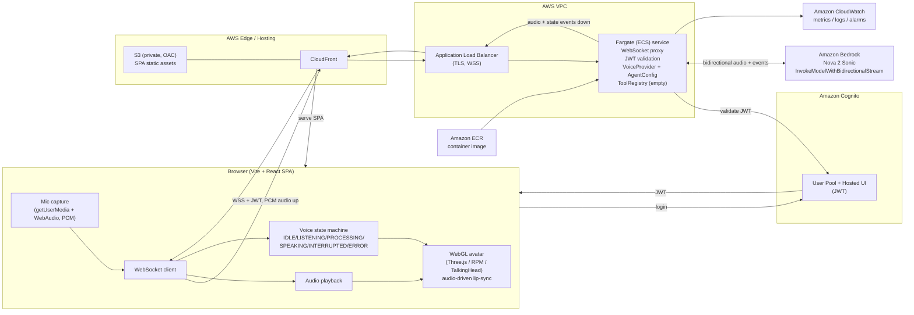

# Architecture Diagram — Phase 0 (Voice + Avatar POC)

Recommended Architecture A: AWS-native speech-to-speech + WebGL avatar.

Notes:
- Browser holds **no AWS credentials**; the Fargate task role calls Bedrock.
- Avatar is driven by the same audio + state events, so it can be swapped without touching voice logic.
- `ToolRegistry` and per-agent `AgentConfig` are present as seams but empty/static in Phase 0.
