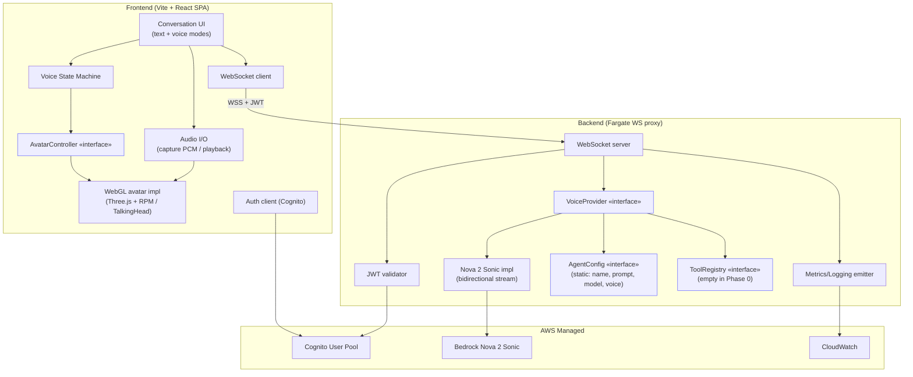

# Component Diagram — Phase 0

Logical components and the four replaceable interfaces.



Replaceable seams (blue = interface):
- **VoiceProvider** — swap Nova 2 Sonic for a STT+LLM+TTS pipeline or another vendor.
- **AgentConfig** — swap the static config for per-agent records (future multi-agent + KB + tools).
- **AvatarController** — swap WebGL for a managed video avatar provider.
- **ToolRegistry** — plug in Lambda / MCP / AgentCore tools later.
```
