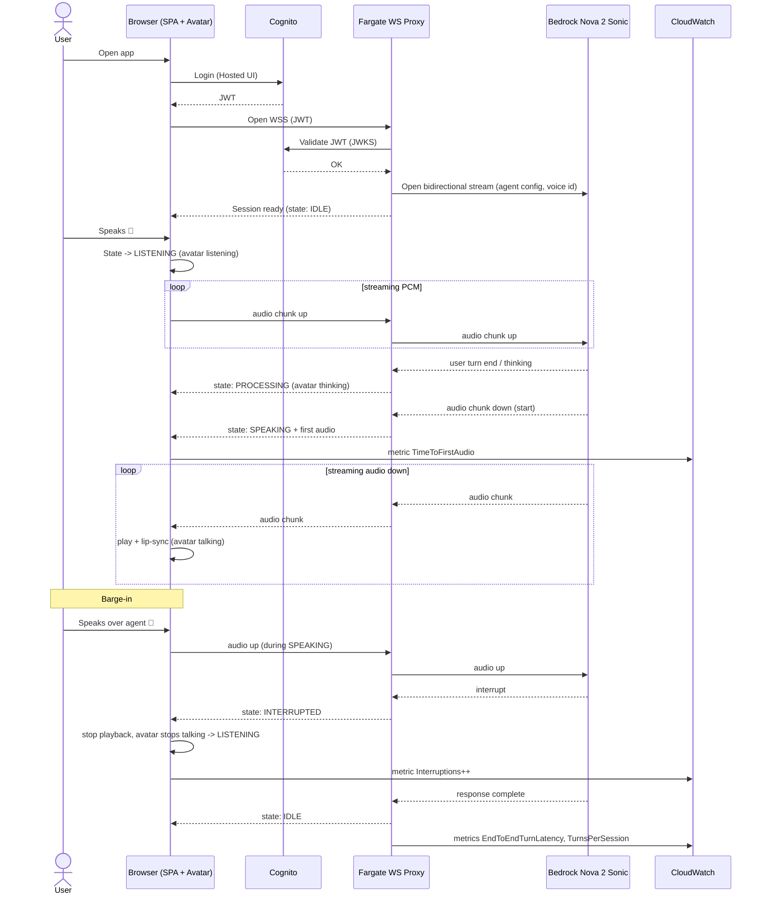

# Voice Sequence Diagram — Phase 0

End-to-end conversational turn, including barge-in.



```text
User
 ↓ speaks
Browser (mic capture, PCM)
 ↓ WSS
Voice layer (Fargate proxy → Nova 2 Sonic bidirectional stream)
 ↓
AI Agent (Nova 2 Sonic: understand + generate)
 ↓ audio + events
Voice response (streamed audio back through proxy)
 ↓
Avatar (state machine: listening → thinking → speaking + lip-sync → idle)
```
